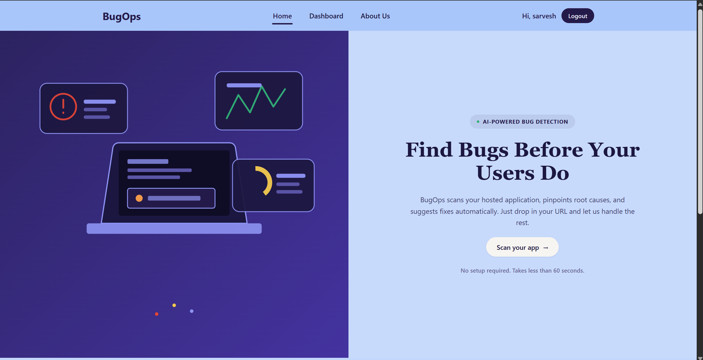
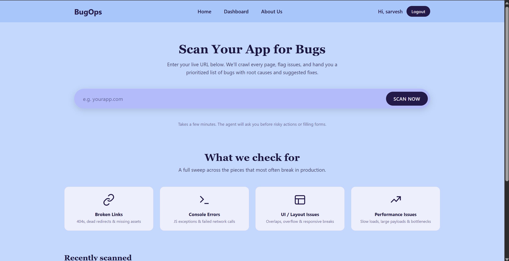
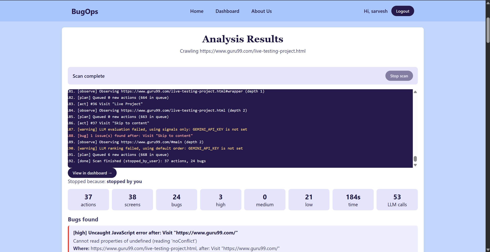
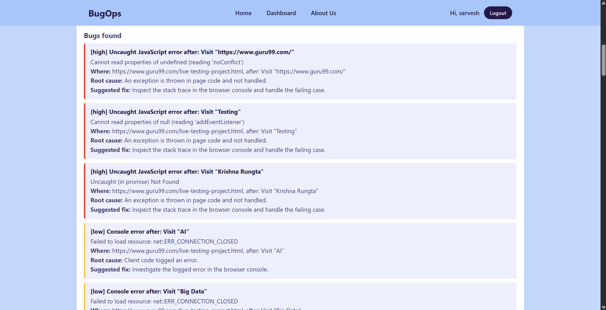
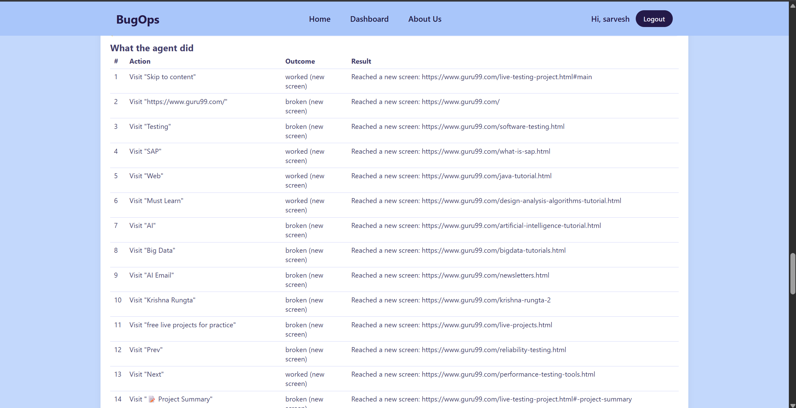
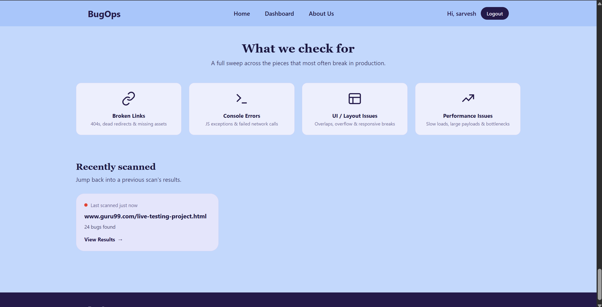

# 🐞 BugOps

**AI-powered bug detection for live web apps.** Paste in a URL, and BugOps crawls your site like a real user, flags issues, and hands you a prioritized list of bugs with root causes and suggested fixes.

> Branch: `react-final` · Fullstack Project, Semester 5



---

## ✨ Features

- **Autonomous crawling agent**: follows an observe → plan → act loop, visiting links page by page (with depth tracking and an action queue).
- **Bug detection** across four categories:
  - 🔗 **Broken links**: 404s, dead redirects, missing assets
  - 🖥️ **Console errors**: JS exceptions and failed network calls
  - 🧩 **UI / layout issues**: overlaps, overflow, responsive breaks
  - ⚡ **Performance issues**: slow loads, large payloads, bottlenecks
- **Severity ranking**: bugs are tagged `high`, `medium` or `low`.
- **Root cause + suggested fix** for every bug found.
- **Live scan log**: watch the agent work in real time, and stop a scan at any time.
- **Action timeline**: a full table of what the agent did and whether each step worked or broke.
- **User accounts & dashboard**: log in, view past scans, and jump back into previous results.
- **LLM-assisted evaluation and ranking** (Gemini), with a graceful fallback to signal-based detection when no API key is set.

---

## 📸 Screenshots

### Scan your app
Enter a live URL and kick off a scan. The page also lists what BugOps checks for.



### Live analysis
A streaming log shows each `observe`, `plan`, `act`, `warning` and `bug` event, along with summary stats (actions, screens, bugs by severity, time, LLM calls).



### Bugs found
Each bug includes its severity, error message, where it happened, the root cause, and a suggested fix.



### What the agent did
A step-by-step record of every action the crawler took and its outcome.



### Recently scanned
Jump back into any previous scan's results from the home page.



---

## 🛠️ Tech Stack

> ⚠️ Fill in / correct this section to match your `package.json` and backend.

| Layer | Technology |
|-------|-----------|
| Frontend | React |
| Backend | _e.g. Node.js / Express_ |
| Crawler / Browser automation | _e.g. Playwright / Puppeteer_ |
| Database | _e.g. MongoDB / PostgreSQL_ |
| AI | Google Gemini API |
| Auth | _e.g. JWT_ |

---

## 📁 Project Structure

> ⚠️ Update to match your repo.

```
Fullstack-Project-Sem-5/
├── client/          # React frontend
├── server/          # Backend API + crawling agent
├── screenshots/     # README images
└── README.md
```

---

## 🚀 Getting Started

### Prerequisites

- Node.js 18+ and npm
- A Google Gemini API key (optional but recommended)

### 1. Clone the repo

```bash
git clone https://github.com/ShrikaNeeharikaC/Fullstack-Project-Sem-5.git
cd Fullstack-Project-Sem-5
git checkout react-final
```

### 2. Install dependencies

```bash
# frontend
cd client
npm install

# backend
cd ../server
npm install
```

### 3. Configure environment variables

Create a `.env` file in the backend folder:

```env
GEMINI_API_KEY=your_gemini_api_key
PORT=5000
# add your DB connection string, JWT secret, etc.
```

> Without `GEMINI_API_KEY`, BugOps still runs, but falls back to signals only (no LLM evaluation or ranking). The scan log will show warnings like `LLM evaluation failed, using signals only`.

### 4. Run the app

```bash
# backend
cd server
npm start

# frontend (new terminal)
cd client
npm start
```

Open **http://localhost:3000** in your browser.

---

## 🧭 How It Works

1. **Submit a URL** on the Scan page.
2. The agent **observes** the current page and collects signals (console errors, failed requests, layout problems).
3. It **plans** by queueing new links and actions to try.
4. It **acts** by visiting each page or link and checking the outcome.
5. Issues are **evaluated** (with the LLM, if available), ranked by severity, and given a root cause and suggested fix.
6. Results are saved to your **dashboard** so you can revisit them later.

---

## 🗺️ Roadmap

- [ ] Smarter, code-aware fix suggestions (replace generic "inspect the console" advice)
- [ ] Form-filling and authenticated-flow scanning
- [ ] Export reports (PDF / CSV)
- [ ] Scheduled and recurring scans
- [ ] Scan comparison across runs

---

## 👥 Authors

- **Sarvesh** and team: Fullstack Project, Semester 5

---

## 📄 License

Add a license of your choice (e.g. MIT).
